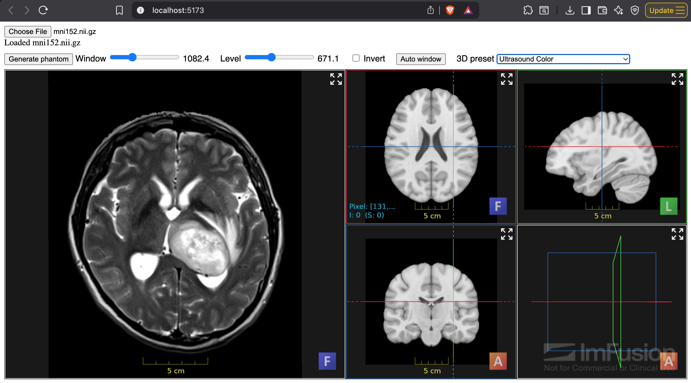

# ImFusion Web Viewer

A small medical image viewer I built in the browser to learn the ImFusion Web SDK. 



## What it does

- Opens a NIfTI scan (`.nii` / `.nii.gz`) and shows axial, sagittal, coronal, and 3D views
- It also supports DICOM
- Window/level sliders, invert, auto-window, and 3D transfer function presets
- A "Generate phantom" button that builds a synthetic sphere volume in code, so I have test data with a known answer


## Testing

The phantom generator has 6 unit tests, each tied to a requirement ID (REQ-PH-001 to 006) covering voxel count, sphere volume, intensity values, determinism, and invalid inputs.

```bash
npm test
```

The viewer UI itself is only checked manually so far.

## Run it

```bash
npm install
npm run dev
```

Open the local URL and choose a scan, or click "Generate phantom." Use free public data only, never real patient data. I used the MNI152 brain template.

*Learning, not a medical device and not for clinical use.*

